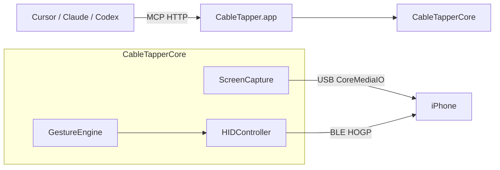

# CableTapper

Mac → real iPhone bridge for AI agents (Zeptap-like).

- **Screen** over USB (CoreMediaIO / AVFoundation)
- **Touch & typing** over Bluetooth LE HID / HOGP (AssistiveTouch; via [BTHIDKit](https://github.com/jqssun/darwin-bt-remote))
- **MCP** on loopback HTTP, started by the app
- A small **SwiftUI** window to advertise, show connected hosts, and mirror the iPhone screen

License: **AGPL-3.0** (required by BTHIDKit). See `LICENSE` and `NOTICE`.

## Architecture

Nothing is installed on the iPhone. Open **CableTapper.app**. It advertises as a Bluetooth keyboard/pointer, serves MCP at `http://127.0.0.1:47801/mcp`, and shows a window for BLE advertising, connected hosts, and a live mirror of the iPhone. Agents use the same process through MCP.



| Channel | Transport | Role |
| --- | --- | --- |
| Screen | USB (CoreMediaIO / AVFoundation) | Live frames, JPEG screenshots, settle detection |
| Touch / type | Bluetooth LE HID over GATT (HOGP) | Absolute pointer + keyboard reports → AssistiveTouch |
| Agents | Local MCP (`127.0.0.1:47801/mcp`) | Tools in the running app; mutating calls return a settled screenshot when USB is up |

**Layout**

- `CableTapper.xcodeproj` — macOS app (debug and release)
- `CableTapperApp` — SwiftUI window and screen mirror
- `Sources/CableTapperMCP` — loopback MCP server
- `Sources/CableTapperCore` — session, capture, BLE HID, gestures, tool router
- `Vendor/BTHIDKit` — vendored [darwin-bt-remote](https://github.com/jqssun/darwin-bt-remote)

Taps map screenshot pixels straight onto an absolute HID pointer (X/Y `0…32767` across the portrait screen). Keep this one app running; it owns the Bluetooth session and the MCP listener.

## Requirements

- macOS 14+
- Xcode / Swift 6.1+
- iPhone on a USB cable, unlocked, Trust this computer
- AssistiveTouch enabled on the iPhone (Settings → Accessibility → Touch → AssistiveTouch)

## Run

Open `CableTapper.xcodeproj` and Run. Xcode builds `CableTapper.app`. Archive that same target to release.

The window starts BLE advertising as **CableTapper**, lists connected hosts, and binds MCP. The mirror on the right shows the USB feed; click or drag on it to tap or drag on the iPhone.

On the iPhone:

1. AssistiveTouch **On**
2. Connect to the Mac over Bluetooth. iOS Settings → Bluetooth lists it under the **Mac's name**, not **CableTapper**; tap that entry and pair.

Recommended: use [nRF Connect](https://apps.apple.com/us/app/nrf-connect-for-mobile/id1054362403) on the iPhone instead. Its scanner shows the advertised name **CableTapper**, so you can tell it apart from the Mac's other Bluetooth services; connect from there and accept the pairing prompt.

Quit other Mac apps that act as a Bluetooth keyboard for that phone.

## MCP

The app listens on `http://127.0.0.1:47801/mcp` while it is open.

```json
{
  "mcpServers": {
    "cabletapper": {
      "url": "http://127.0.0.1:47801/mcp"
    }
  }
}
```

## Tools

Coordinates are screenshot pixels (origin top-left). Every tool except `status` returns a settled JPEG when USB capture is available. Mutating tools also accept `settle_ms`, the maximum wait for the screen to stop changing (default 3000).

| Tool | Arguments | What it does |
| --- | --- | --- |
| `status` | — | Bluetooth, BLE host, and USB capture state |
| `screenshot` | — | Settled screenshot |
| `wait` | `ms` (default 1000, max 120000) | Sleep, then screenshot |
| `tap` | `x`, `y` | Single tap |
| `double_tap` | `x`, `y` | Two taps 80 ms apart |
| `long_press` | `x`, `y`, `duration_ms` (default 800) | Press and hold |
| `drag` | `from_x`, `from_y`, `to_x`, `to_y`, `duration_ms` (default 800) | Press, glide, release |
| `flick` | `x`, `y`, `direction` (`up`/`down`/`left`/`right`) | 180 ms swipe over 30% of the short side, keeps momentum |
| `type_text` | `text` | Type US-keyboard ASCII into the focused field |
| `press_key` | `key`, `modifiers`, `repeat` | Keys: `enter`, `escape`, `backspace`, `tab`, `space`, arrows, `a`, `c`, `v`, `x`, `z`. Modifiers: comma-separated `command`, `shift`, `control`, `alternate` |
| `home` | — | Swipe up from the home-indicator strip to the Home Screen |
| `back` | — | Swipe right from the left edge past mid-screen |

Check the returned screenshot after `home` or `back`. If the page did not change, calling once more is safe for `home`; for `back`, make sure the first swipe really failed so you do not go back two levels.

## Notes

- The pointer is an absolute HID device driven through AssistiveTouch. An iPhone paired with an older CableTapper build must forget the device and pair again so it reads the new report map.
- The absolute pointer is clamped to the screen, so swipes that start on the bezel are not possible.
- iOS ignores a press that lands the instant the pointer reaches a screen edge, so `home` and `back` rest at the start point for 200 ms before pressing. Hardware shortcuts (AC Home, Cmd-H, Globe-H) did not reach the Home Screen in testing.
- Auto-enabling AssistiveTouch over USB lockdown is deferred.
