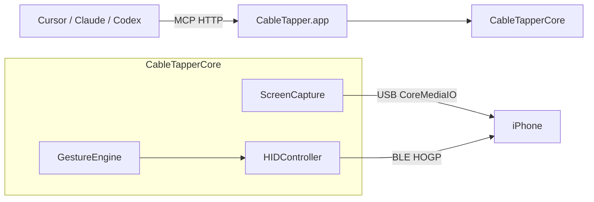

# CableTapper

Mac → real iPhone bridge for AI agents (Zeptap-like).

- **Screen** over USB (CoreMediaIO / AVFoundation)
- **Touch & typing** over Bluetooth LE HID / HOGP (AssistiveTouch; via [BTHIDKit](https://github.com/jqssun/darwin-bt-remote))
- **MCP** on loopback HTTP, started by the app
- A small **SwiftUI** window to advertise and show connected hosts

License: **AGPL-3.0** (required by BTHIDKit). See `LICENSE` and `NOTICE`.

## Architecture

Nothing is installed on the iPhone. Open **CableTapper.app**. It advertises as a Bluetooth keyboard/pointer, serves MCP at `http://127.0.0.1:47801/mcp`, and shows a window for BLE advertising and connected hosts. Agents use the same process through MCP.



| Channel | Transport | Role |
| --- | --- | --- |
| Screen | USB (CoreMediaIO / AVFoundation) | Live frames, JPEG screenshots, settle detection |
| Touch / type | Bluetooth LE HID over GATT (HOGP) | Absolute pointer + keyboard reports → AssistiveTouch |
| Agents | Local MCP (`127.0.0.1:47801/mcp`) | Tools in the running app; mutating calls return a settled screenshot when USB is up |

**Layout**

- `CableTapper.xcodeproj` — macOS app (debug and release)
- `CableTapperApp` — SwiftUI window
- `Sources/CableTapperMCP` — loopback MCP server
- `Sources/CableTapperCore` — session, capture, BLE HID, gestures, tool router
- `Vendor/BTHIDKit` — vendored [darwin-bt-remote](https://github.com/jqssun/darwin-bt-remote)

Taps map screenshot pixels straight onto an absolute HID pointer (X/Y `0…32767` across the portrait screen). Keep this one app running; it owns the Bluetooth session and the MCP listener.

## Requirements

- macOS 14+
- Xcode / Swift 6.1+
- iPhone on a USB cable, unlocked, Trust this computer
- AssistiveTouch enabled on the iPhone (Settings → Accessibility → Touch → AssistiveTouch)

## Run

Open `CableTapper.xcodeproj` and Run. Xcode builds `CableTapper.app`. Archive that same target to release.

The window starts BLE advertising as **CableTapper**, lists connected hosts, and binds MCP.

On the iPhone:

1. AssistiveTouch **On**
2. Settings → Bluetooth → tap **CableTapper**

Quit other Mac apps that act as a Bluetooth keyboard for that phone.

## MCP

The app listens on `http://127.0.0.1:47801/mcp` while it is open.

```json
{
  "mcpServers": {
    "cabletapper": {
      "url": "http://127.0.0.1:47801/mcp"
    }
  }
}
```

## Tools

`status`, `screenshot`, `wait`, `tap`, `double_tap`, `long_press`, `drag`, `flick`, `type_text`, `press_key`, `home`, `back`

Coordinates are screenshot pixels (origin top-left). Mutating tools return a settled JPEG when USB capture is available.

## Notes

- The pointer is an absolute HID device driven through AssistiveTouch. An iPhone paired with an older CableTapper build must forget the device and pair again so it reads the new report map.
- The absolute pointer is clamped to the screen, so swipes that start on the bezel are not possible.
- Auto-enabling AssistiveTouch over USB lockdown is deferred.
